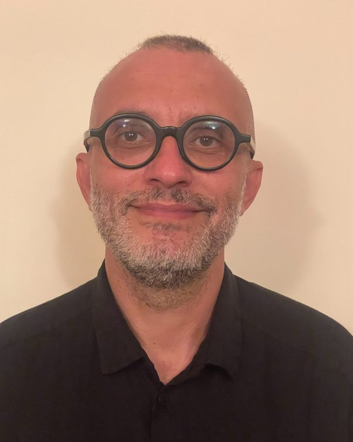
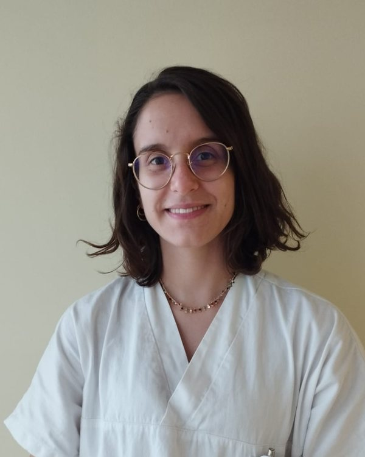
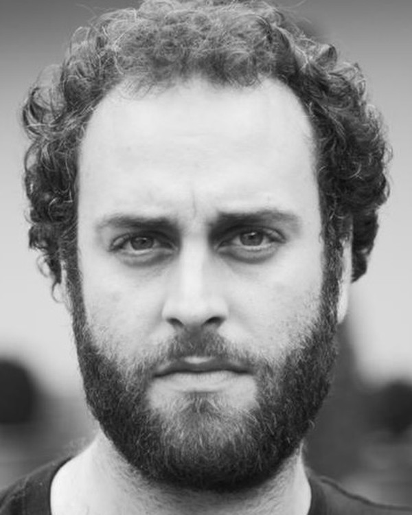
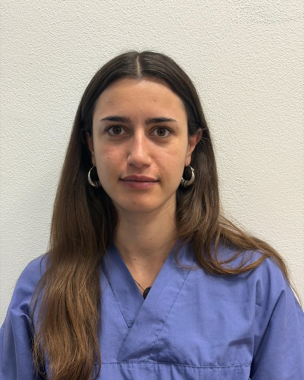
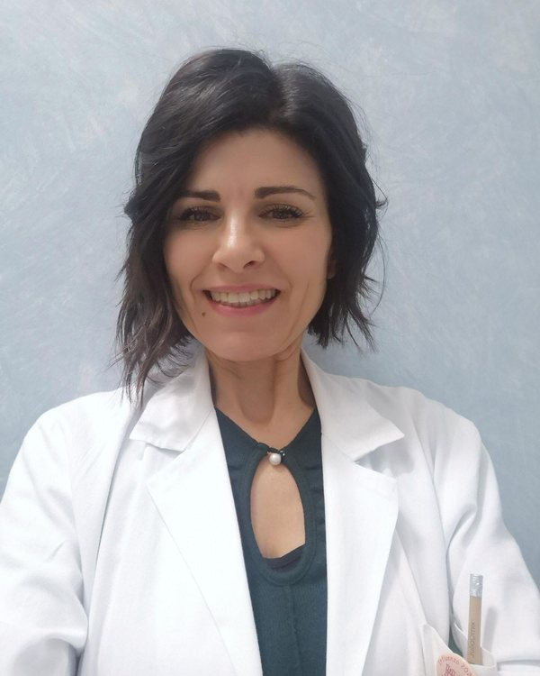
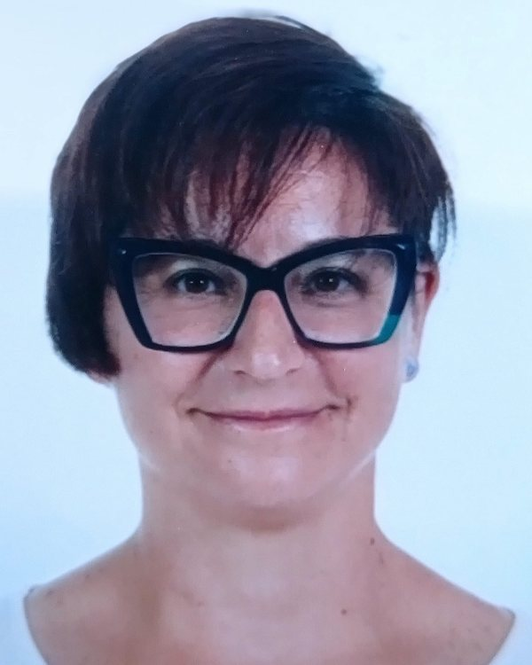
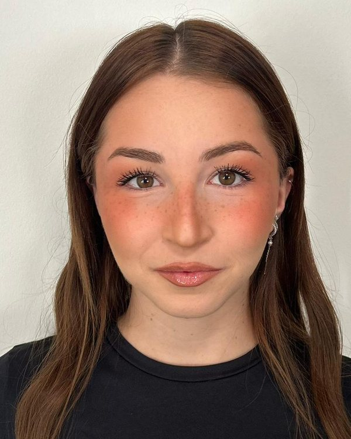

::: {.nm-wrap .nm-hero}
```{=html}
<svg class="nm-hero-art" viewBox="0 0 820 760" role="img" aria-label="Illustration of a motor unit: one axon branching onto four of six striated muscle fibres">
  <g class="on"><line class="fib" x1="40" y1="230" x2="790" y2="230"/><line class="str" x1="58" y1="230" x2="772" y2="230"/></g>
  <g class="off"><line class="fib" x1="10" y1="300" x2="760" y2="300"/><line class="str" x1="28" y1="300" x2="742" y2="300"/></g>
  <g class="on"><line class="fib" x1="70" y1="370" x2="810" y2="370"/><line class="str" x1="88" y1="370" x2="792" y2="370"/></g>
  <g class="on"><line class="fib" x1="30" y1="440" x2="770" y2="440"/><line class="str" x1="48" y1="440" x2="752" y2="440"/></g>
  <g class="off"><line class="fib" x1="90" y1="510" x2="800" y2="510"/><line class="str" x1="108" y1="510" x2="782" y2="510"/></g>
  <g class="on"><line class="fib" x1="50" y1="580" x2="780" y2="580"/><line class="str" x1="68" y1="580" x2="762" y2="580"/></g>
  <path class="myelin" d="M 520 -10 C 515 60, 495 110, 470 150"/>
  <path class="ax" stroke-width="3.5" d="M 520 -10 C 515 60, 495 110, 470 150"/>
  <path class="ax" stroke-width="2.5" d="M 470 150 C 520 165, 585 178, 610 202"/>
  <path class="ax" stroke-width="2.5" d="M 470 150 C 400 190, 320 250, 300 342"/>
  <path class="ax" stroke-width="2.5" d="M 470 150 C 560 220, 690 300, 700 412"/>
  <path class="ax" stroke-width="2.5" d="M 470 150 C 462 300, 444 450, 450 552"/>
  <path class="ap" stroke-width="4" d="M 520 -10 C 515 60, 495 110, 470 150"/>
  <path class="apb" stroke-width="3" d="M 470 150 C 520 165, 585 178, 610 202"/>
  <path class="apb" stroke-width="3" d="M 470 150 C 400 190, 320 250, 300 342"/>
  <path class="apb" stroke-width="3" d="M 470 150 C 560 220, 690 300, 700 412"/>
  <path class="apb" stroke-width="3" d="M 470 150 C 462 300, 444 450, 450 552"/>
  <g class="ep"><circle class="halo" cx="610" cy="208" r="30"/><circle cx="596" cy="210" r="6"/><circle cx="607" cy="204" r="6"/><circle cx="619" cy="206" r="6"/><circle cx="628" cy="212" r="5"/><circle cx="603" cy="217" r="5"/></g>
  <g class="ep"><circle class="halo" cx="300" cy="348" r="30"/><circle cx="286" cy="350" r="6"/><circle cx="297" cy="344" r="6"/><circle cx="309" cy="346" r="6"/><circle cx="318" cy="352" r="5"/><circle cx="293" cy="357" r="5"/></g>
  <g class="ep"><circle class="halo" cx="700" cy="418" r="30"/><circle cx="686" cy="420" r="6"/><circle cx="697" cy="414" r="6"/><circle cx="709" cy="416" r="6"/><circle cx="718" cy="422" r="5"/><circle cx="693" cy="427" r="5"/></g>
  <g class="ep"><circle class="halo" cx="450" cy="558" r="30"/><circle cx="436" cy="560" r="6"/><circle cx="447" cy="554" r="6"/><circle cx="459" cy="556" r="6"/><circle cx="468" cy="562" r="5"/><circle cx="443" cy="567" r="5"/></g>
</svg>
<div class="nm-hero-text">
  <h1>From motor neuron to muscle fibre.</h1>
  <p class="nm-lead">We study the neuromuscular system as one working unit: the neuron, the junction, and the fibre it drives. Clinic, bench and data, in Padova.</p>
  <div class="nm-actions">
    <a class="nm-btn nm-btn-muscle" href="contact.html#work">Join the lab</a>
    <a class="nm-btn nm-btn-ghost" href="research.html">Our research</a>
  </div>
</div>
<div class="nm-hero-meta">
  <div><strong>Prof. Gianni Sorarù</strong><span>Principal investigator</span></div>
  <div><strong>Department of Neuroscience</strong><span>Università degli Studi di Padova</span></div>
  <div><strong>Motor Neuron Disease Centre</strong><span>Azienda Ospedale Università Padova</span></div>
</div>
```
:::

```{=html}
<section class="nm-wrap nm-unit" aria-labelledby="unit-title">
  <div class="nm-unit-head">
    <h2 id="unit-title">One motor unit, five lines of research</h2>
    <p>Each line studies a different part of the same unit: the genes in the neuron's nucleus, the RNA in its cell body, the signal along its axon, the junction where it ends, and the muscle fibre it drives.</p>
  </div>
  <ol class="nm-stations">
  <li class="nm-station nm-at-nucleus">
    <div class="nm-station-mark"><span class="nm-node" aria-hidden="true"></span><span class="nm-part">Nucleus</span></div>
    <div class="nm-station-body">
      <h3><a href="research.html#genetics">Genetics</a></h3>
      <p>Population datasets such as the UK Biobank show that repeat expansions and risk variants for neuromuscular disease are more common than diagnosed cases suggest. We estimate who carries them and what changes their effect.</p>
      <a class="nm-station-paper" href="https://doi.org/10.1002/ana.78195"><span>High prevalence of SOD1 pathogenic variants in the UK Biobank</span><em>Ann Neurol · 2026</em></a>
    </div>
  </li>
  <li class="nm-station nm-at-soma">
    <div class="nm-station-mark"><span class="nm-node" aria-hidden="true"></span><span class="nm-part">Cell body</span></div>
    <div class="nm-station-body">
      <h3><a href="research.html#tdp-43-and-rna">TDP-43 and RNA</a></h3>
      <p>When TDP-43 leaves the nucleus, cells include cryptic exons that switch off genes such as UNC13A and STMN2. With UCL Queen Square we map these events, test them as biomarkers and study splice-correcting therapies.</p>
      <a class="nm-station-paper" href="https://doi.org/10.1038/s41586-026-11256-2"><span>UNC13A splice correction rescues synaptic dysfunction induced by TDP-43 loss</span><em>Nature · 2026</em></a>
    </div>
  </li>
  <li class="nm-station nm-at-axon">
    <div class="nm-station-mark"><span class="nm-node" aria-hidden="true"></span><span class="nm-part">Axon</span></div>
    <div class="nm-station-body">
      <h3><a href="research.html#als-biomarkers">ALS biomarkers</a></h3>
      <p>We combine neurophysiology, MRI and [18F]FDG-PET with fluid markers such as neurofilaments and chitinases to measure upper and lower motor neuron involvement and to predict how ALS will progress.</p>
      <a class="nm-station-paper" href="https://doi.org/10.1002/acn3.70521"><span>Metabolic and fluid biomarkers support microglia activation in amyotrophic lateral sclerosis</span><em>Ann Clin Transl Neurol · 2026</em></a>
    </div>
  </li>
  <li class="nm-station nm-at-junction">
    <div class="nm-station-mark"><svg class="nm-endplate" viewBox="0 0 40 28" aria-hidden="true"><circle cx="8" cy="16" r="5"/><circle cx="17" cy="10" r="5"/><circle cx="27" cy="12" r="5"/><circle cx="34" cy="19" r="4"/><circle cx="15" cy="22" r="4"/></svg><span class="nm-part">Junction</span></div>
    <div class="nm-station-body">
      <h3><a href="research.html#muscle-and-junction">Muscle and junction</a></h3>
      <p>Muscle is more than a passive victim of motor neuron loss. In patient biopsies and disease models we study regeneration, innervation and the neuromuscular junction, and develop ELISA assays for new biomarkers.</p>
      <a class="nm-station-paper" href="https://doi.org/10.1111/bpa.13328"><span>Protective role of angiogenin in muscle regeneration in ALS</span><em>Brain Pathol · 2024</em></a>
    </div>
  </li>
  <li class="nm-station nm-at-fibre">
    <div class="nm-station-mark"><span class="nm-node" aria-hidden="true"></span><span class="nm-part">Fibre</span></div>
    <div class="nm-station-body">
      <h3><a href="research.html#sbma">SBMA</a></h3>
      <p>We follow people with Kennedy's disease over many years, measure the smallest changes in function that patients notice, and coordinate the clenbuterol trial in SBMA.</p>
      <a class="nm-station-paper" href="https://doi.org/10.1002/mus.70457"><span>Longitudinal progression of 6-minute walk test-derived fatigability in SBMA</span><em>Muscle Nerve · 2026</em></a>
    </div>
  </li>
  </ol>
</section>

<section class="nm-wrap nm-people-strip" aria-labelledby="people-title">
  <div class="nm-people-copy">
    <h2 id="people-title">Clinicians and scientists, side by side</h2>
    <p>Neurologists, a neurophysiologist, a neuropsychologist, lab scientists, a biostatistician and the trial team work on the same patients and the same questions.</p>
    <a class="nm-arrow" href="people.html">Meet the team</a>
  </div>
  <ul class="nm-faces">
    <li></li>
    <li></li>
    <li></li>
    <li></li>
    <li></li>
    <li></li>
    <li></li>
    <li></li>
    <li></li>
    <li></li>
    <li></li>
  </ul>
</section>
```

:::::: {.nm-wrap .nm-home-feeds}
::: nm-home-col
## Latest papers



[All publications](publications.qmd){.nm-arrow}
:::

:::: nm-home-col
## News

::: {#news-home}
:::

[All news](news.qmd){.nm-arrow}
::::
::::::

```{=html}
<section class="nm-joinfield" aria-labelledby="join-title">
  <div class="nm-wrap nm-join-inner">
    <h2 id="join-title">Join the lab</h2>
    <div>
      <p>We welcome students, residents and postdocs interested in neuromuscular disease, at the bench, in the clinic or with data. Tell us what you would like to work on.</p>
      <a class="nm-btn nm-btn-ink" href="contact.html#work">Write to us</a>
    </div>
  </div>
</section>
<nav class="nm-wrap nm-routes" aria-label="Other visitors">
  <a href="patients.html">For patients and families</a>
  <a href="pazienti.html" lang="it">Per pazienti e famiglie</a>
  <a href="trials.html">Clinical trials and sponsors</a>
</nav>
```

::: nm-wrap
[Keep scrolling to discover our research](research.qmd){.nm-next}
:::
