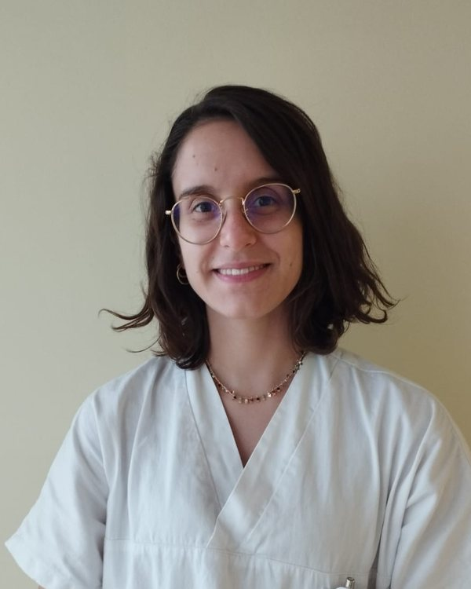
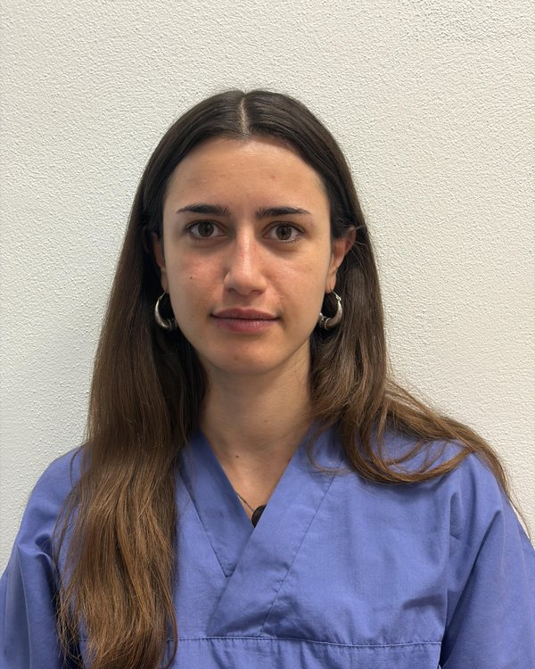
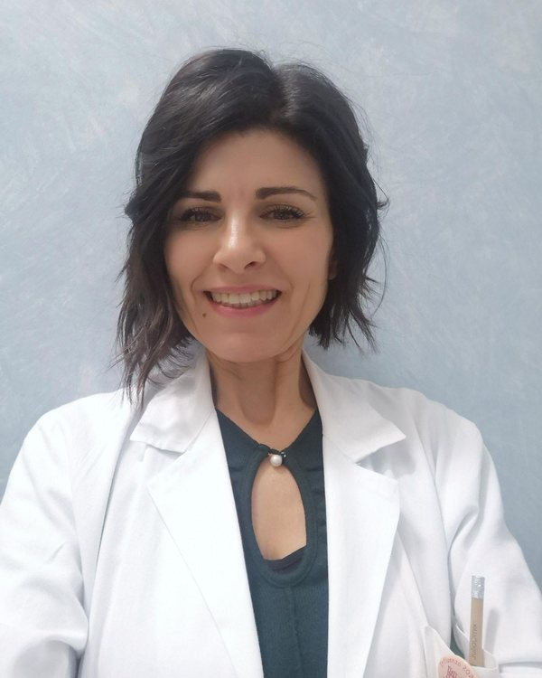
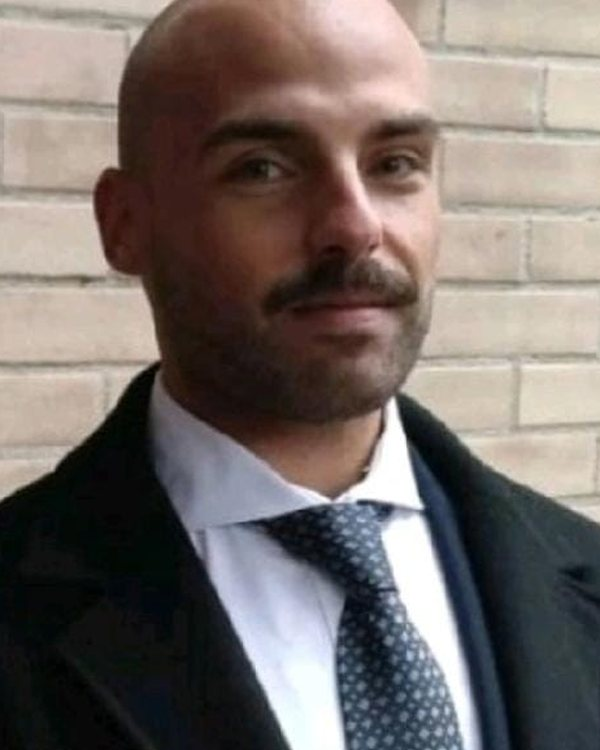

::: nm-wrap

::: nm-pagehead
# Meet the team

Neurologists, neurophysiologists, researchers and clinical research staff working between the neuromuscular clinic and the lab.
:::

<!-- Team list from the "TRICALS / WEBSITE" doc. Cards marked .nm-nophoto have no picture;
     to add one, put a 4:5 photo in images/team/, add an image line and drop .nm-nophoto. -->

::: nm-team

::: nm-person
{fig-alt="Prof. Gianni Sorarù"}
[Prof. Gianni Sorarù]{.nm-name}
[Associate Professor of Neurology]{.nm-role}
[ALS, SBMA and other motor neuron diseases]{.nm-focus}
:::

::: nm-person
{fig-alt="Dr. Giacomo Maria Minicuci"}
[Dr. Giacomo Maria Minicuci]{.nm-name}
[Neurologist, Neurophysiologist · Co-Investigator]{.nm-role}
[SBMA outcome measures and ALS biomarkers]{.nm-focus}
:::

::: nm-person
{fig-alt="Dr. Federica Paredi"}
[Dr. Federica Paredi]{.nm-name}
[Neurology Resident · Co-Investigator]{.nm-role}
[SBMA clinical outcomes and cognition]{.nm-focus}
:::

::: nm-person
{fig-alt="Dr. Matteo Zanovello"}
[Dr. Matteo Zanovello]{.nm-name}
[Neurology Resident · Co-Investigator]{.nm-role}
[TDP-43 cryptic exons, repeat expansions and SBMA]{.nm-focus}
:::

::: nm-person
{fig-alt="Dr. Isabella Cannata"}
[Dr. Isabella Cannata]{.nm-name}
[Clinical Research Fellow · Co-Investigator]{.nm-role}
:::

::: nm-person
{fig-alt="Serenella Salmaso"}
[Serenella Salmaso]{.nm-name}
[Case Manager]{.nm-role}
:::

::: nm-person
{fig-alt="Silvia Lazzaretto"}
[Silvia Lazzaretto]{.nm-name}
[Trial Manager]{.nm-role}
:::

::: {.nm-person .nm-nophoto}
[Dr. Sara Vianello]{.nm-name}
[Senior Lab Technician]{.nm-role}
:::

::: nm-person
{fig-alt="Edoardo Girotto"}
[Edoardo Girotto]{.nm-name}
[PhD Student]{.nm-role}
[Phosphorylated tau in ALS skeletal muscle]{.nm-focus}
:::

::: nm-person
{fig-alt="Francesco Cavallo"}
[Francesco Cavallo]{.nm-name}
[Research Assistant]{.nm-role}
:::

::: nm-person
{fig-alt="Marta Conforti"}
[Marta Conforti]{.nm-name}
[Research Assistant]{.nm-role}
[Developing ELISA assays for new biomarkers]{.nm-focus}
:::

::: {.nm-person .nm-nophoto}
[Sonia Marcato]{.nm-name}
[Neuropsychologist]{.nm-role}
:::

::: nm-person
{fig-alt="Dr. Daniele Sabbatini"}
[Dr. Daniele Sabbatini]{.nm-name}
[Biostatistician]{.nm-role}
:::

::: {.nm-person .nm-nophoto}
[Prof. Elena Pegoraro]{.nm-name}
[Head of Neuromuscular Laboratory]{.nm-role}
:::

:::

::: nm-join
::: {}
## Join us

Prospective students and postdocs are welcome. Send us your CV and a brief statement of interest.
:::
[Work with us](contact.qmd){.nm-btn .nm-btn-muscle}
:::

[Keep scrolling to our publications](publications.qmd){.nm-next}

:::
