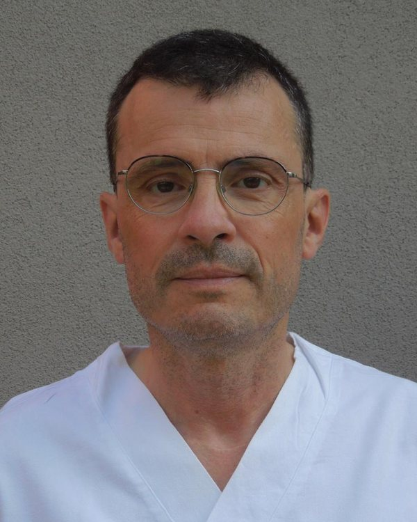
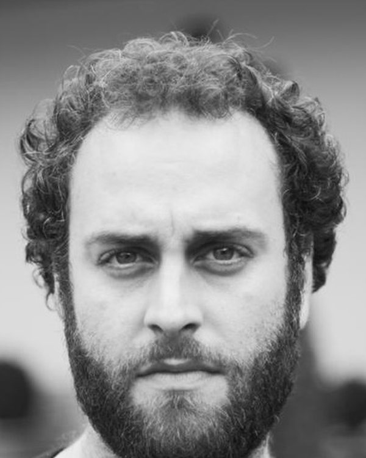
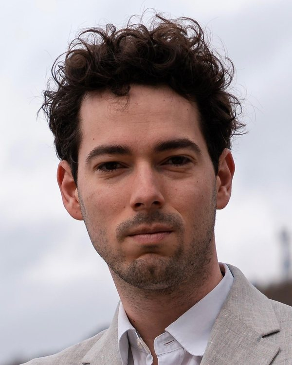
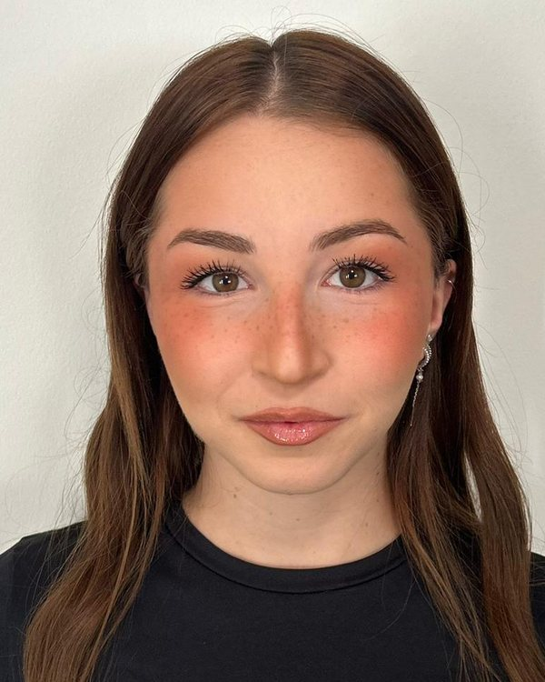
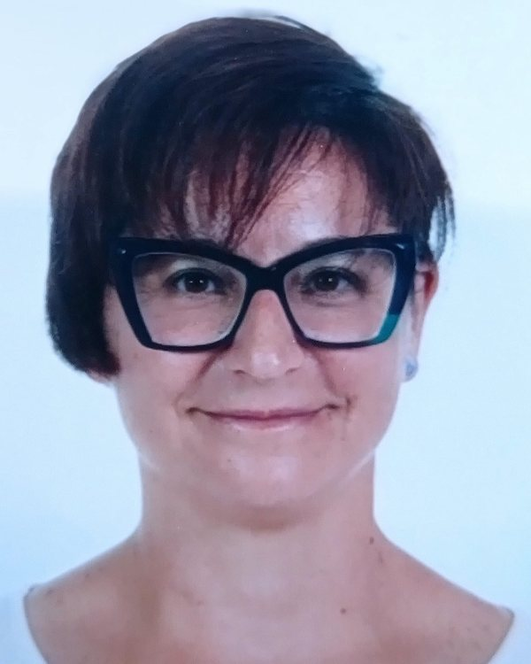

::::::::::::::: nm-wrap
::: nm-pagehead
# Meet the team

Neurologists, neurophysiologists, researchers and clinical research staff working between the neuromuscular clinic and the lab.
:::

::::::::::: nm-team
::: nm-person
{fig-alt="Gianni Sorarù"} [Gianni Sorarù]{.nm-name} [Principal investigator]{.nm-role} [ALS, SBMA and other motor neuron diseases]{.nm-focus}
:::

::: nm-person
{fig-alt="Giacomo Maria Minicuci"} [Giacomo Maria Minicuci]{.nm-name} [Neurologist and neurophysiologist]{.nm-role} [SBMA outcome measures and ALS biomarkers]{.nm-focus}
:::

::: nm-person
{fig-alt="Matteo Zanovello"} [Matteo Zanovello]{.nm-name} [Neurology resident and postdoc]{.nm-role} [TDP-43 cryptic exons, repeat expansions and SBMA]{.nm-focus}
:::

::: nm-person
{fig-alt="Federica Paredi"} [Federica Paredi]{.nm-name} [Neurology resident]{.nm-role} [SBMA clinical outcomes and cognition]{.nm-focus}
:::

::: nm-person
{fig-alt="Edoardo Girotto"} [Edoardo Girotto]{.nm-name} [PhD student]{.nm-role} [Phosphorylated tau in ALS skeletal muscle]{.nm-focus}
:::

::: nm-person
{fig-alt="Marta Conforti"} [Marta Conforti]{.nm-name} [Research assistant]{.nm-role} [Developing ELISA assays for new biomarkers]{.nm-focus}
:::

::: nm-person
{fig-alt="Serenella Salmaso"} [Serenella Salmaso]{.nm-name} [Case manager]{.nm-role}
:::

::: nm-person
{fig-alt="Silvia Lazzaretto"} [Silvia Lazzaretto]{.nm-name} [Clinical trial manager]{.nm-role}
:::
:::::::::::

:::: nm-join

## Join us

Prospective students and postdocs are welcome. Send us your CV and a brief statement of interest.

[Work with us](contact.qmd){.nm-btn .nm-btn-muscle}
::::

[Keep scrolling to our publications](publications.qmd){.nm-next}
:::::::::::::::
